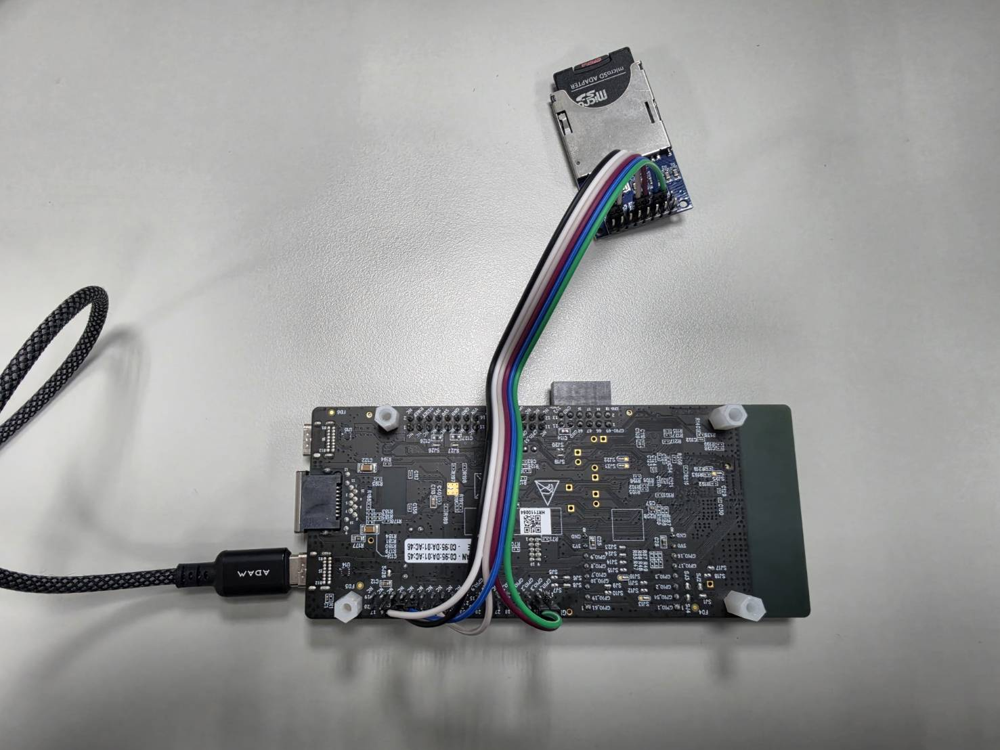
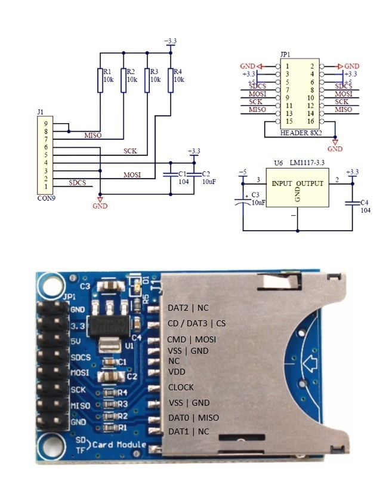

# FRDM-RW612 microSD over SPI + FatFs

MCUXpresso SDK 專案：FRDM-RW612 以 Flexcomm1 SPI 連接 microSD（SPI mode），使用 FatFs。

> **Demo，僅供參考，非正式產品。** 本程式用於示範做法，未經量產等級的驗證，也不提供技術支援或維護承諾。實機只測過一張 32 GB SDHC 卡與 RAM 執行的 debug build，用於產品前請自行驗證。

| 專案 | 內容 |
|---|---|
| [frdmrw612_sdspi_fatfs](frdmrw612_sdspi_fatfs/) | 裸機版，含 SD-SPI 驅動、FatFs 接合層、測試程式。接線與除錯方法見其 readme |
| [frdmrw612_sdspi_fatfs_freertos](frdmrw612_sdspi_fatfs_freertos/) | FreeRTOS 版，直接編譯裸機版的 `source/`，兩個資料夾必須放在一起 |

## 硬體

接線表見[裸機版 readme](frdmrw612_sdspi_fatfs/readme.md)。

實際接線：



SD 外接板資料（電路圖、腳位、尺寸）：



## 建置前準備

本 repo 不含 SDK。需要 MCUXpresso SDK 26.09.00（FRDM-RW612）與 Arm GNU Toolchain 14.2。

在兩個專案資料夾內各做一次：

1. 把 `mcux_include.json.template` 複製成 `mcux_include.json`。
2. 把其中的 `<TOOLS_DIR>`（通常是 `C:/Users/你的帳號/.mcuxpressotools`）與 `<SDK_ROOT>` 換成本機路徑。
3. 把 `.vscode/mcuxpresso-tools.json` 的 `sdk.path` 改成本機的 SDK 路徑。

然後：

```
cmake --preset flash_debug
cmake --build --preset flash_debug
```

## 授權

本 repo 自行撰寫的程式以 [BSD-3-Clause](LICENSE) 授權，按現狀提供，不附任何擔保。

第三方檔案維持各自檔頭的授權：NXP 板級檔與 SVD 為 BSD-3-Clause，`FreeRTOSConfigBoard.h` 為 MIT，`ffconf.h` 為 FatFs 授權。

`docs/images/` 內的圖片不在上述授權範圍內。
